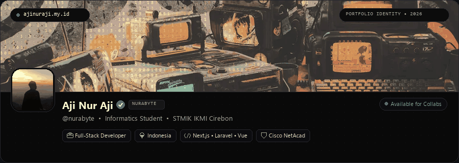

  

  

  
  
  
  
  

---

### ⚡ About Me

I am **Aji Nur Aji**, an informatics student and developer based in Indonesia. I focus on building resilient web applications, designing scalable backend systems, and shipping clean software that solves real problems.

- 🔭 Engineering full-stack products and exploring modern architectures.
- 🌱 Deepening knowledge in system design, distributed infrastructure, and microservices.
- 💬 Ask me about **Laravel**, **Next.js**, **Vue**, **Python**, or clean code paradigms.

---

### 🛠️ Tech Stack

**Frontend**
 

  

**Backend & Database**
 

  

**Tools & Infrastructure**
 

---

### 📊 GitHub Activity

  <table border="0">
    <tr>
      <td>
        
      </td>
      <td>
        
      </td>
    </tr>
  </table>
   
  

---

### 🐍 Contribution Graph

  <picture>
    <source media="(prefers-color-scheme: dark)" srcset="https://raw.githubusercontent.com/AjiNurAji/ajinuraji/output/github-contribution-grid-snake-dark.svg">
    <source media="(prefers-color-scheme: light)" srcset="https://raw.githubusercontent.com/AjiNurAji/ajinuraji/output/github-contribution-grid-snake.svg">
    
  </picture>

---

  "Build for clarity. Delete ruthlessly. Ship real software."

